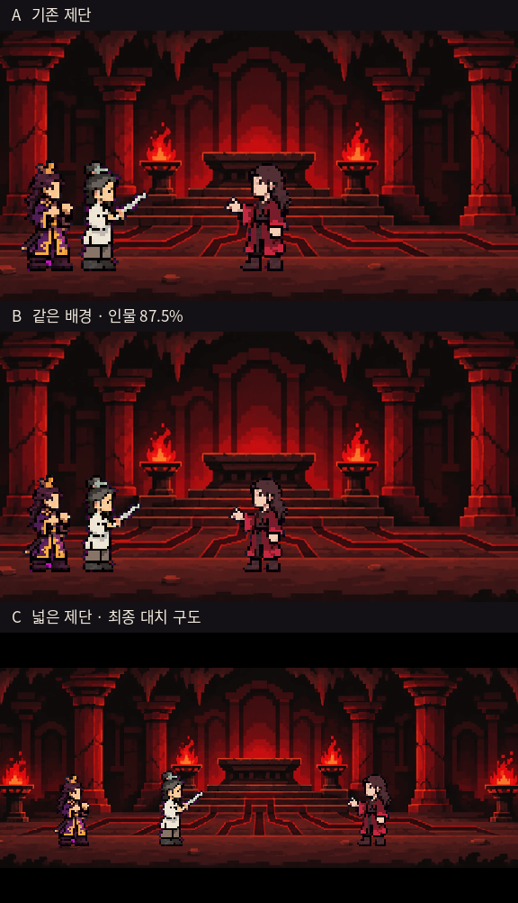
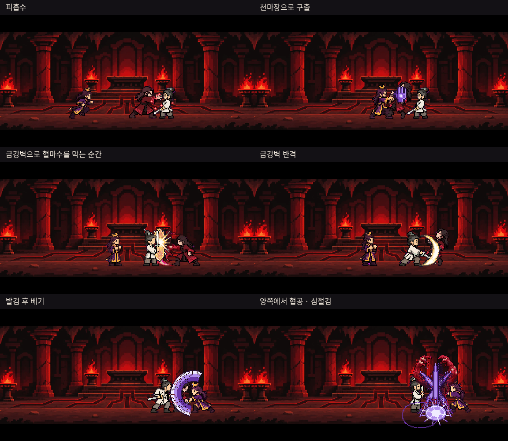
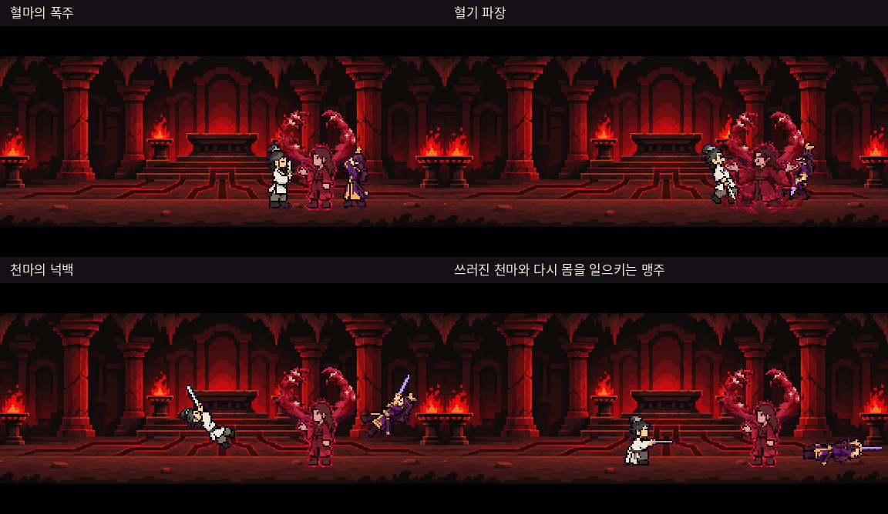
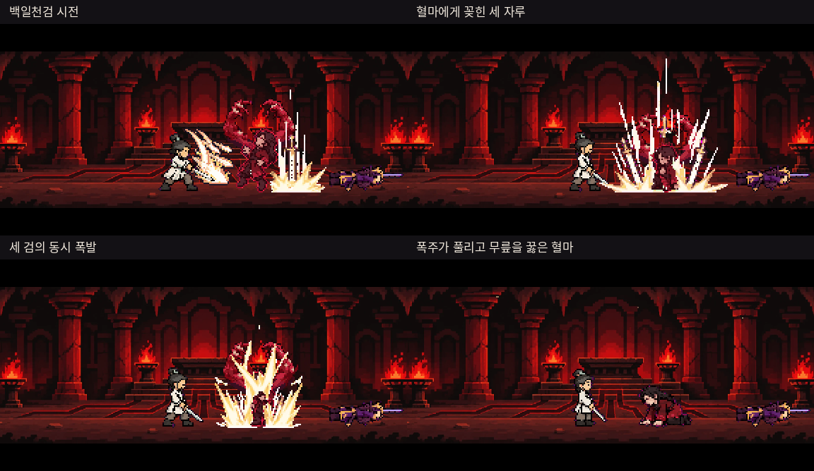
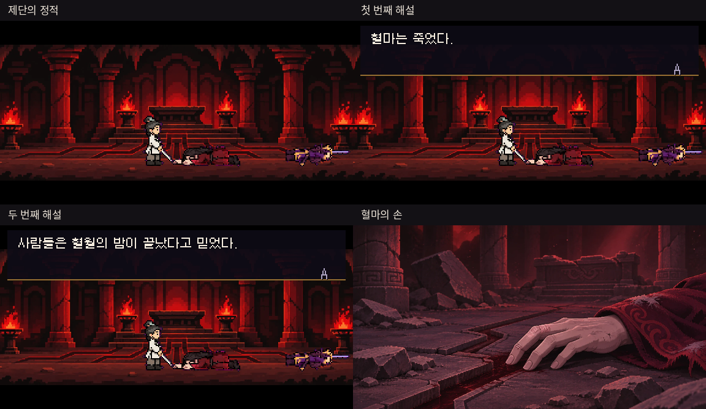

# 서장 · 혈교 제단

[결전 전체 영상 (MP4, 576×300, 초당 20프레임)](duel.mp4)

## 제단 구도

A는 기존 카메라가 900px 원화의 중앙 576px를 보여 주는 화면이다. B는 같은 자리에서 인물만 87.5%로 줄였다. 적용한 C는 원화 약 778px를 보여 주며 양쪽 화로와 중앙 계단이 한눈에 들어온다. 화면 위아래에 여백을 두고 배경 비율을 유지했다. 인물과 기술은 원화 한 픽셀을 화면 두 픽셀로 그린다.

## 결전

## 사용한 게임 자산

배경은 `web/data/maps/blood_altar.png`와 `hyeolma_hand.png`다. 세 사람은 `web/data/hi/sd/`의 `baekmujin_f`, `cheonma_f`, `cheonmasw_f`, `hyeolma_f` 스프라이트를 사용한다. 당시의 맹주와 천마는 현대 인물과 별개다.

혈마의 두 팔과 파장은 `hyeolma_fx/farm_0~3.png`, `wave_0~5.png`다. 맹주의 백일천검은 시전 자세 `bs_0~4.png`와 상대 쪽 `baekmujin_fx/fall_0~5.png`를 함께 쓴다. 피흡수, 천마장, 발검 후 베기와 삼절검은 대전의 이펙트 함수를 같은 위치·배율로 재생한다.

## 재현

웹 빌드 후 프리뷰를 4173번 포트에 띄우고 `node tools/harness/web/prologue_altar.js /tmp/altar-shots`를 실행하면 기본 크기의 개별 PNG를 얻을 수 있다. 이 테스트는 A키 연타와 무입력 대기에서 결전 길이, 두 해설의 순서, 세 사람의 마지막 위치, 손 장면의 지속시간과 다음 장면 연결을 검사한다.
