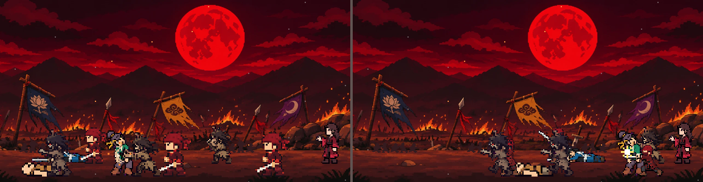
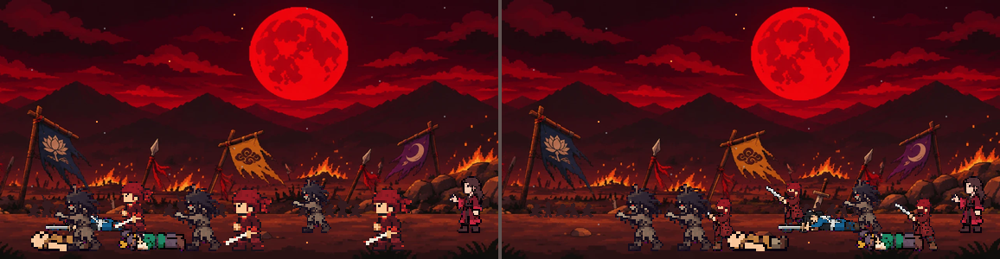
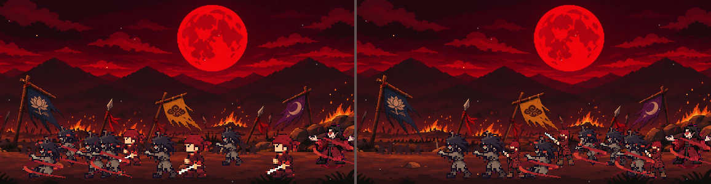
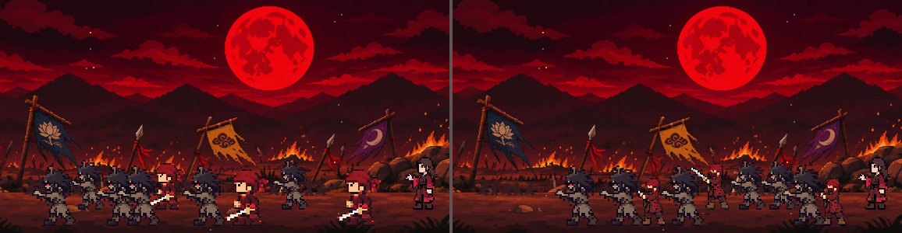
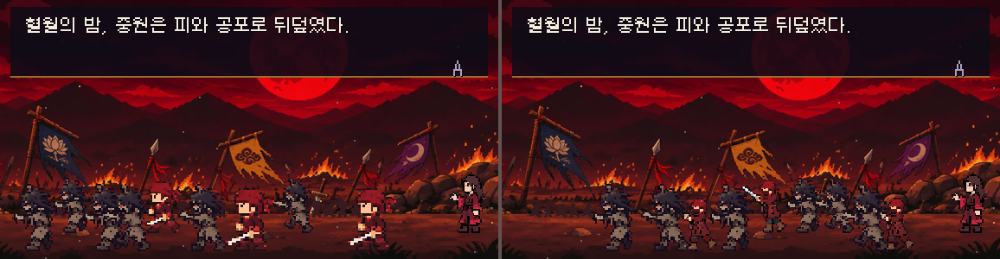

# 서장 전쟁 · 혈교도 협공과 포위

각 이미지의 왼쪽은 수정 전(26cacf1), 오른쪽은 수정 후다. 같은 시뮬레이션 틱에 게임 캔버스 전체를 캡처했다.

| 장면 | 수정 전 · 수정 후 |
|---|---|
| 협공. 혈강시가 압박하는 동안 붉은 두건의 검수가 반대편에서 마지막 권사를 찌른다. |  |
| 기상 직전. 오른쪽에서 쓰러진 세 무인을 혈교 병력이 둘러싼다. |  |
| 기상 중. 기존 병력은 자기 자리를 지키고, 쓰러진 권사·검객·수도승은 차례로 일어난다. |  |
| 기상 직후. 혈마 앞에 혈교도 셋과 혈강시 여섯이 서 있다. |  |
| 진군 시작. 해설과 함께 아홉 명이 왼쪽으로 발을 내딛는다. |  |
