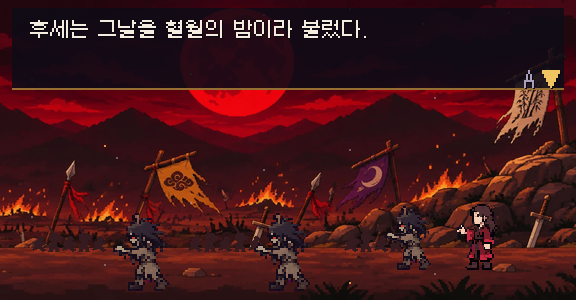
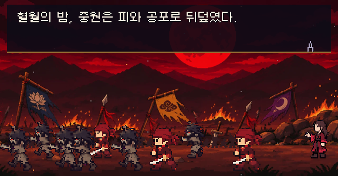
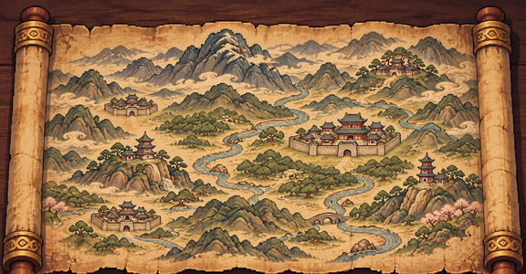
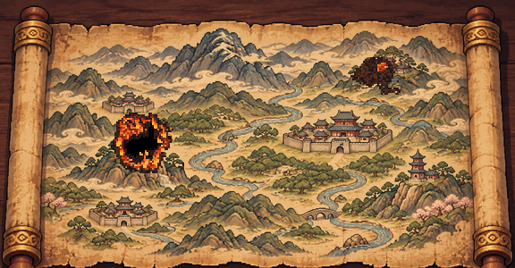
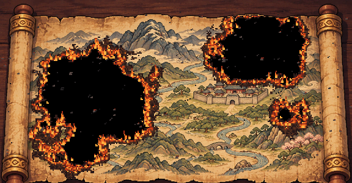
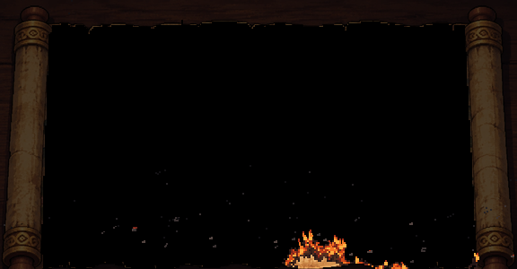
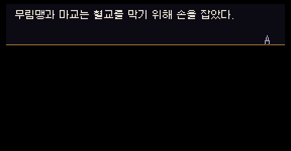
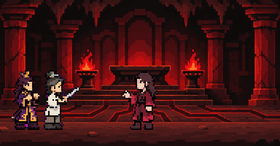

# 혈월의 밤과 중원 지도

[지도 등장부터 혈교 제단까지 실제 재생 속도 GIF](map-burn.gif)

| 혈월의 밤 명명 | 최종 진군 |
|---|---|
|  |  |
| **연소 전 지도** | **첫 불씨** |
|  |  |
| **종이에 난 구멍** | **마지막 종이와 재** |
|  |  |
| **암전 후 정마연합 해설** | **혈교 제단** |
|  |  |
