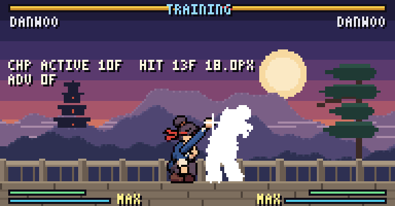

# 단우 대전 2B 프레임표

단위는 60Hz 대전 프레임이다. 즉시 실행하는 기술은 입력을 받은 프레임이 1F다. 발동 길이는 첫 공격 판정 전까지의 프레임 수다. 회복에는 일반 행동으로 돌아가는 전환 프레임을 포함했다. 기존 엔진에서는 그 다음 프레임부터 새 행동을 시작한다.

| 기술 | 발동 길이 | 첫 활성 | 활성 구간 | 회복 길이 | 헛친 뒤 다음 행동 |
|---|---:|---:|---|---:|---:|
| 서서 약손 | 6 | 7F | 7–12F | 10 | 23F |
| 서서 강발 | 12 | 13F | 13–21F | 19 | 41F |
| 앉아 강손 | 9 | 10F | 10–18F | 25 | 44F |

## 접촉과 유불리

단우 미러전에서 같은 입력을 좌우 방향으로 반복했다. 각 조건을 두 번 실행해 한 번은 공격자, 한 번은 방어자가 접촉 직후부터 점프를 입력했다. 아래 두 숫자는 각자의 점프가 실제로 시작된 프레임이다. 방어자에서 공격자의 값을 빼면 공격자 기준 유불리가 된다. 접촉 거리는 두 캐릭터 중심 간 거리다.

| 시작 거리·기술 | 결과 | 접촉 | 실제 거리 | 공격자 / 방어자 다음 행동 | 유불리 |
|---|---|---:|---:|---:|---:|
| 12px 약손 | 명중 | 7F | 12px | 32F / 35F | +3F |
| 12px 약손 | 가드 | 7F | 12px | 29F / 26F | −3F |
| 12px 강발 | 명중 | 13F | 12px | 53F / 59F | +6F |
| 12px 강발 | 가드 | 13F | 12px | 47F / 44F | −3F |
| 12px 앉아 강손 | 명중 | 10F | 12px | 56F / 53F | −3F |
| 12px 앉아 강손 | 가드 | 10F | 12px | 50F / 38F | −12F |
| 18px 앉아 강손 | 명중 | 13F | 18px | 56F / 56F | 0F |

트레이닝 화면의 ACTIVE는 첫 공격 판정, HIT·GUARD는 실제 접촉 프레임과 거리, WHIFF는 헛침을 표시한다. ADV는 캔슬 없이 일반 행동을 시작할 때의 차이다. CANCEL은 이전 기술의 입력을 기준으로 후속 기술이 시작된 프레임이다. 입력이 히트스톱 중에 버퍼에 들어가면 해당 기술의 첫 활성·접촉 표시에는 대기한 프레임도 포함된다.



## 실전 예제

- 약손이 7F에 맞은 뒤 8F에 후속 버튼을 한 번 입력하면 후속 기술은 17F에 시작한다. 12px의 약손→약손은 7F와 23F에 각각 30 피해를 준다. 15px에서 후속 약손은 헛치고 후속 강손은 26F에 90 피해를 준다.
- 12px에서 앉아 강손을 서서 막으면 방어자는 38F에 반격할 수 있다. 이 프레임에 버튼을 한 번 눌렀을 때 약손은 헛치고, 강손과 약발은 모두 47F에 닿아 각각 90·40 피해를 준다. 반격이 없을 때 원래 공격자의 다음 행동은 50F다.
- 독립 브라우저 페이지에서 불러오는 데이터의 약손 발동만 6→7로 변경했다. 실제 첫 공격 판정과 체력 감소가 모두 7F→8F로 이동했다.

## 재현

Playwright와 Chromium이 있는 환경에서 `web`의 의존성을 설치하고 아래와 같이 실행한다.

```sh
cd web
npm ci
npm run dev -- --host 127.0.0.1 --port 4190 --strictPort
```

별도 터미널의 저장소 루트에서 `node evidence/combat-phase2b/verify.cjs`를 실행한다. 이 검사는 기본 수치로 후속 행동 28건, 연계 6건, 반격 6건, 헛침 6건을 실행해 기준 커밋의 측정값과 대조한다. 이어서 테스트 전용 발동 변경을 검사하고 결과와 트레이닝 화면을 저장한다. `CHROME_PATH`로 Chromium 실행 경로를 지정할 수 있다.

`2168026.json`은 기준 커밋의 웹판에서 같은 DOM 입력과 게임 루프로 측정한 로그다. 다시 생성하려면 해당 커밋으로 띄운 Vite 주소를 `GAME_URL`에 넣고 같은 스크립트에 `baseline` 인수를 전달한다. `results.json`에는 기본 수치와 발동 변경 시의 공격 판정, 접촉, 체력 변화, 점프 및 캔슬 시작 시각이 들어 있다.

기본 수치에서 2A의 트레이닝·ARCADE 그림자전·싱글 VS CPU 태그 전후 56건과 Chromium 지연 키·터치 입력 회귀가 통과했다. 서장 완료 후 개인편 6개가 열렸고 브라우저 오류는 0건이었다. 온라인 락스텝 양측 입력 재생은 130프레임 모두 일치했고 최종 해시는 610093141이었다. TypeScript 검사와 Vite 빌드도 통과했다.
