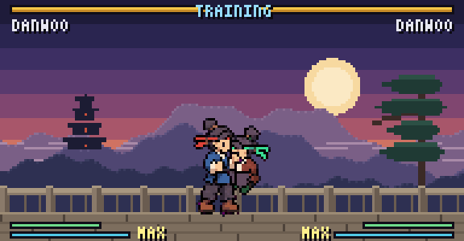

# 단우 앉아 강손 대공 → 서서 강발 → 착지



중심 거리 12px에서 상대가 1F에 수직 점프한다. 단우가 3F에 ↓+S를 입력하고 아래 방향을 뗀 뒤 58F에 X를 누른다. 12F에 앉아 강손, 70F에 서서 강발이 맞고 상대는 85F에 다운 자세로 착지한다. GIF는 실제 게임 캔버스를 대전 2프레임마다 캡처해 30fps로 재생한다. 표의 프레임은 시도 시작부터 센 60Hz 프레임이고, 높이는 상대 발과 지면 사이의 월드 픽셀 거리다.

## 같은 키 입력으로 비교한 결과

| 측정 | 가로 6px·높이 22px에서 시작 | 12px에서 실제 수직 점프 |
|---|---|---|
| ↓+S / X 입력 | 1F / 56F | 3F / 58F |
| 대공 명중 (두 버전 동일) | 10F · 80 피해 · 거리 6px · 높이 18.389px | 12F · 80 피해 · 거리 12px · 높이 12.222px |
| 대공 직후 수평 속력 (기준 → 3A) | 2.2 → 0.55px/기존 틱 | 2.2 → 0.55px/기존 틱 |
| 기준 7c0cb35의 X | 헛침 · 총 1타 80 피해 | 헛침 · 총 1타 80 피해 |
| 3A의 X 명중 | 68F · 100 피해 · 거리 10.833px · 높이 9.444px | 70F · 100 피해 · 거리 16.833px · 높이 3.278px |
| X 사용 시 착지 (기준 → 3A) | 74F → 86F · 총 2타 180 피해 | 73F → 85F · 총 2타 180 피해 |
| X 생략 시 착지 (기준 → 3A) | 74F → 74F · 거리 44.133 → 15.533px | 73F → 73F · 거리 47.933 → 20.983px |
| X 입력 가능 구간 (기준 → 3A) | 성공 없음 → **41–61F** | 성공 없음 → **43–59F** |
| 너무 늦은 X | 62F 입력, 헛침 | 60F 입력, 헛침 |

수평 속력의 단위인 기존 1틱은 대전 3프레임이다. 위 입력 구간은 X를 한 번 누른 **버튼 프레임**이다. 회복 중 일찍 누른 입력은 기존 버퍼에 들어가며, 강발을 시작할 수 있는 첫 프레임은 각각 56F와 58F다. 창을 찾기 위해 X 입력을 1~115F까지 한 프레임씩 이동시켰다. 직접 키를 넣은 대표 시도와 창 밖의 헛침은 별도로 기록했다.

## 피격과 탈출

- 대공에 맞은 상대는 기존 대공의 수직 궤적을 따라가고 수평으로 ¼만 밀린다. 공중 피격 자세인 `hit_1`의 불투명 픽셀을 발 기준으로 좌우 반전해 피격 영역으로 쓴다. 단우 미러전에서 실제 그림의 538개 월드 픽셀이 양방향 모두 피격 영역과 일치했다.
- 가드 방향 유지와 점프 유지를 별도 입력했다. 두 입력 모두 첫 명중 뒤에 수신됐고, 방어자는 두 번째 명중 전에 가드나 점프로 전환하지 못했다. 강발이 맞는 프레임의 게임 내부 콤보 카운트는 2였다.
- 2타 직후에는 낙하 속도를 이어받고 다운 상태로 들어간다. 같은 체공 중에는 피격 영역이 비어 있다. 별도 검사에서는 공격자의 기존 명중 기록을 비우고 활성 강발을 낙하 그림의 실제 픽셀에 겹쳐 판정을 재실행했다. 추가 피해는 0, 콤보는 2였다.
- 후속타 없이 착지하면 기존 다운·기상 절차로 이어진다. 지상 단우 미러전의 2B 발동과 유불리, 동시타 결과도 기준과 일치했다.

## 재현

Playwright, Chromium, FFmpeg가 있는 환경에서 검사할 버전의 `web` 디렉터리에서 Vite 개발 서버를 실행한다. 저장소 루트에서 기본 주소(4190) 또는 `GAME_URL`로 서버를 지정한다.

```sh
node evidence/combat-phase3a/verify.cjs after
```

기준 로그는 `7c0cb35`의 Vite 서버를 지정해 같은 스크립트에 `before`를 전달하면 재생성된다. Chromium 기본 경로는 `/usr/bin/chromium`이며 `CHROME_PATH`로 변경할 수 있다.

트레이닝, ARCADE 여섯 번째 그림자전, 싱글 VS CPU 태그 전·후에 진입해 두 거리 조건과 좌우 방향을 교차 검사했다. 총 16조건이다. 공격과 점프는 Chromium 키보드로 입력했고, 테스트 페이지에서 상대 더미의 입력만 보조 키보드에 연결했다. 6px 조건은 기존 대공 검사를 위해 공중 시작 위치와 자세를 설정한다. 12px 조건은 두 캐릭터가 땅에서 시작한다. 키 입력 창 전체 탐색에는 DOM 키 이벤트를 사용했다.

- `before.json`, `after.json`에 입력·기술 시작·명중·피해·접촉 거리와 높이·콤보·착지·탈출 시도를 담았다.
- `node evidence/combat-phase2a/verify.cjs after-3a`로 기존 2A 시계·거리 검사를 실행한다. 기준 로그와 비교할 때 대공 수평 변위에만 ¼을 적용한다. 결과는 `2a-regression.json`에 기록한다.
- 2B 후속 행동 28건, 연계·반격·헛침 각 6건, 테스트용 발동 +1F, 동시타 12건과 양방향 동시 KO가 통과했다. 서장 완료 및 개인편 6개 해금에서 브라우저 오류는 0건이었다. 온라인은 양측 입력을 130프레임 재생해 매 프레임 해시가 일치했고 최종 해시는 610093141이었다. TypeScript 검사와 Vite 빌드도 통과했다.
