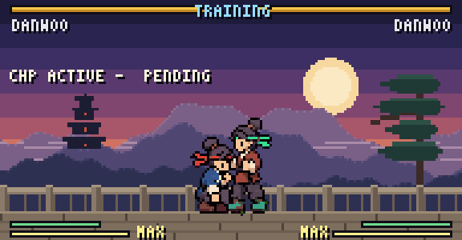

# 단우 앉아 강손 지상 카운터 → 서서 강발 → 다운 착지



12px에서 1F에 단우가 ↓+S, 7F에 상대가 X, 56F에 단우가 X를 눌렀다. 3B에서는 상대 강발의 발동 중에 앉아 강손이 맞아 **13F 카운터 → 68F 공중 강발 → 88F 다운 착지**로 이어졌다. 카운터 배율은 첫 타에 한 번 적용되어 80 × 1.25 = 100, 두 번째 강발은 100으로 총 200 피해였다.

| 같은 입력의 결과 | 기준 4a8c705 | 3B |
|---|---|---|
| 13F 앉아 강손, 중심 거리 12px | 100 피해, 지상 피격 | 100 피해, 띄우기 |
| 첫 타 직후 속도, px/기존 50ms 틱 | 바깥쪽 2.2, 수직 0 | 바깥쪽 0.55, 수직 −4.5 |
| 68F 강발 | 지상 일반 명중, 거리 15.684px, 콤보 1 | 공중 명중, 거리 16.283px, 발 높이 9.556px, 콤보 2 |
| 강발 명중 뒤 착지 | 지상 유지 | 88F 다운, 거리 22.15px |
| 56F X 생략 | 지상 카운터 1타 | 100 피해 1타, 76F 다운 착지 |

## X 입력 경계

1~120F에서 X를 한 프레임씩 옮겼다. TRAINING, ARCADE 여섯 번째 그림자전, 싱글 VS CPU 태그 전·후의 양방향 8조건에서 성공 구간은 모두 **41~62F**였다. 기준판에는 공중 2타가 성립하는 프레임이 없었다.

| X 입력 | 실제 강발 시작 | 결과 |
|---|---|---|
| 40F | 발동 없음 | 버튼은 수신했지만 앉아 강손 회복이 끝나기 전에 입력 버퍼 만료 |
| 41F | 56F | 68F 공중 명중 |
| 56F | 56F | 68F 공중 명중 |
| 62F | 62F | 74F 공중 명중, 발 높이 2.722px |
| 63F | 63F | 강발 헛침, 상대 76F 착지 |

## 탈출·추가타·예외

- 방어자가 14F부터 가드 방향 또는 점프를 각각 유지했다. 입력은 14F에 기록됐고 어느 쪽도 68F 강발을 피하지 못했다.
- 2타 직후 착지까지 피격 영역이 비었다. 별도 검사에서 기존 명중 기록을 비우고 활성 강발을 낙하 자세의 불투명 픽셀 위에 겹쳐 충돌 검사를 다시 실행했다. 추가 피해 0, 콤보 2였다.
- 12px 일반 명중은 10F에 80 피해로 지상 피격, 서서 가드는 10F에 피해 0이었다. 상대가 16px에서 4F에 약손을 내면 이미 활성 중인 13F에 앉아 강손을 일반 명중으로 맞아 80 피해를 받고 지상에 남았다.
- 상대 체력 100에서 첫 타가 카운터 KO를 내면 공중 후속타가 열리지 않았다. 13F KO, 초기 수직 속도 −3.5, 82F 착지였다. 네 대조군의 기록은 양방향 전 모드에서 기준판과 일치했다.

## 재현과 회귀

Playwright, Chromium, FFmpeg를 준비하고 각 버전의 web 디렉터리에서 Vite 개발 서버를 실행한다. 저장소 루트에서 아래 명령을 실행하면 기준과 변경 후 로그를 차례로 만들 수 있다. 기본 Chromium 경로는 /usr/bin/chromium이며 CHROME_PATH로 바꿀 수 있다.

```sh
# 4205에는 4a8c705, 4190에는 3B 개발 서버를 실행한 상태
GAME_URL=http://127.0.0.1:4205 node evidence/combat-phase3b/verify.cjs before
GAME_URL=http://127.0.0.1:4190 node evidence/combat-phase3b/verify.cjs after
```

[기준 로그](before.json)와 [3B 로그](after.json)에 양측 공격 입력, 기술 시작, 피해 적용 직전 상대의 지상·발동·활성 상태, 접촉 거리·높이, 콤보 수와 착지를 기록했다. 대표 입력과 경계 네 곳은 Chromium 키보드로 재현했고, 전 구간 탐색은 같은 게임 입력 경로에 DOM 키 이벤트를 보냈다. 테스트 페이지에서 상대 입력을 보조 키보드에 연결해 프레임을 맞췄다. GIF는 실제 게임 캔버스를 대전 2프레임마다 담은 30fps 영상이다.

| 다시 실행한 검사 | 결과 |
|---|---|
| 3A 대공, 두 거리 조건·좌우·태그 포함 16조건 | 기존 2타·착지·입력 구간 모두 일치 |
| 2B 지상 프레임표 | 실제 다음 행동 28건, 연계·반격·헛침 각 6건, 발동 1F 변경 통과 |
| 동시타와 동시 KO | 동시타 12건의 실제 점프와 표시 유불리 일치, 양방향 동시 KO 통과 |
| 2A 시계·거리 | 입력·충돌·타이머·CPU 관찰 지연 검사 통과 |
| 스토리 서장 | 완료 저장, 개인편 6개 진입, 브라우저 오류 0건 |
| 온라인 락스텝 | 양측 130프레임의 상태 해시 일치, 최종 610093141 |
| 웹 빌드 | TypeScript 검사와 Vite 프로덕션 빌드 통과 |
